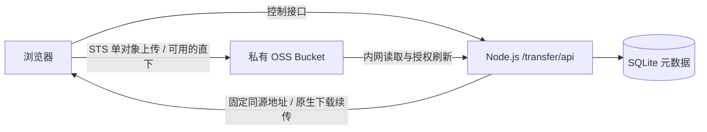

# fast-changyi

长翼久安闪传中心的开源版本：一个基于阿里云 OSS 的网页文件上传、分享和下载工具。

[](https://github.com/Tangtaizong-BUAA/fast-changyi/actions/workflows/ci.yml)
[](LICENSE)


## 功能

- 浏览器直接上传 OSS：小文件 PUT、大文件 Multipart、断点续传和取消。
- 上传完成后生成分享链接与取件码，最近文件列表支持直接下载。
- 文件默认永久保留，`expires_at = NULL`，界面正确区分永久文件和已过期文件。
- 支持 File System Access API 的浏览器可直接分段下载到磁盘，验证 Range、大小和 ETag。
- 保存权限被拒绝、浏览器不支持或 CORS 无法核验时，切换本站固定地址下载；上游授权过期会刷新，断流会按已发送字节恢复。
- 原生下载接口支持 GET、HEAD、单段 Range 和 ETag 条件续传，并通过回压控制内存。
- 无前端构建步骤；Node.js、SQLite 和一个 OSS SDK 依赖即可运行。

这是公开共享文件区：默认无需登录，访问者可上传并查看最近文件。它没有个人账户、租户隔离或私密文件 ACL；保留的历史口令接口不会保护公开路由。需要私有部署时，应在反向代理或网络层配置访问控制。

## 本地运行

需要 Node.js **22.13 或更新版本**和 npm。

```bash
git clone https://github.com/Tangtaizong-BUAA/fast-changyi.git
cd fast-changyi
npm ci
cp .env.example .env
npm start
```

打开 <http://127.0.0.1:8810/transfer/>。安装时会从锁定的 `ali-oss` npm 包生成浏览器 SDK 和许可证，不依赖已删除的本地 vendor 文件。

未配置云资源时可以预览空白页面；真实上传下载需要填写自己的 OSS Bucket、Region、Endpoint、上传 RAM Role 和凭证。不要使用历史文档里的示例资源作为真实配置。

生产环境推荐 ECS RAM 实例角色；本地联调可在未跟踪的 `.env` 中设置自己短期、最小权限的 `ALIYUN_ACCESS_KEY_ID`、`ALIYUN_ACCESS_KEY_SECRET`、`ALIYUN_SECURITY_TOKEN`。详细步骤见 [部署说明](docs/DEPLOYMENT.md)。

## 架构



上传始终直达 OSS。兼容下载经过应用服务器，受服务器公网带宽限制；同 Region 的 ECS 可通过内网读取 OSS。OSS 直下仍需要正确的 CORS（包括暴露 `Content-Range` 和 `ETag`）。

## 开发与验证

```bash
npm run check
npm test
npm run check-release
```

测试使用合成数据、假凭证、临时数据库和本机 HTTP 服务，不连接真实云资源。初始版本包含 50 项原有回归，覆盖保存权限被拒绝、签名过期、真实 TCP 断流、超时、取消、Range/ETag/长度校验、背压及 4 GiB 以上偏移。

历史原项目曾完成 128 MiB 公网完整下载与哈希比对；那是当时原部署的验收，不代表你的环境或所有文件规模已验证。超过 6 小时的上传、完成/取消竞态等已知边界见 [已知限制](docs/KNOWN_LIMITATIONS.md)。

## 目录

| 路径 | 内容 |
| --- | --- |
| `server.mjs` | HTTP API、SQLite、STS、文件元数据及清理 |
| `download-grant.mjs` | 签名期限与凭证期限约束 |
| `native-download.mjs` | 固定地址、流式兼容下载与续传 |
| `public/` | 原生 HTML、CSS、JavaScript 界面和下载器 |
| `tests/` | HTTP、服务端、下载器与 UI 回归 |
| `deploy/` | systemd、Nginx、RAM 与 CORS 示例 |
| `scripts/` | SDK 准备、公开内容检查和历史运维辅助脚本 |
| `design-system/` | 原项目设计规范 |
| `docs/history/` | 经脱敏的设计、实施、审计与发布记录 |

开源包包含项目源码、测试、部署示例和工程文档。运行数据库、真实配置、临时验收包、私人截图、另行下载的论文和第三方工具存档保留在原工作区，没有放进公共仓库。

## 许可证

[MIT](LICENSE)。第三方依赖仍按各自许可证分发，见 [THIRD_PARTY_NOTICES.md](THIRD_PARTY_NOTICES.md)。
