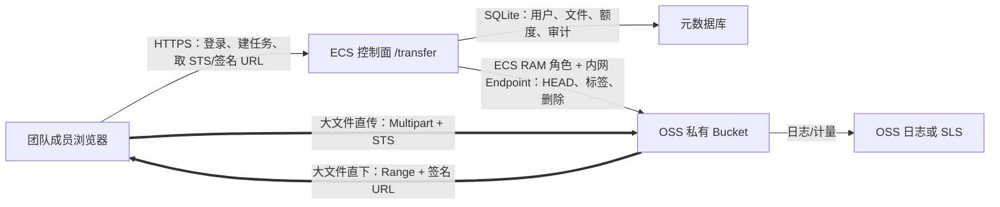

> 历史工程记录的开源脱敏副本。文中的部署结果属于原项目当时的验证记录，示例域名、账号、路径不能用于访问原部署；当前配置以仓库 README 和 docs/DEPLOYMENT.md 为准。

# 基于阿里云 OSS 的团队超大文件传输方案（历史长周期稿）

> **此稿已被新的 2 小时临时中转需求取代，不作为实施依据。**<br>
> 当前权威规划见：[两小时OSS高速中转实施规划.md](./两小时OSS高速中转实施规划.md)。

> 状态：技术方案已敲定，尚未执行云资源变更或生产部署<br>
> 现状核查日期：2026-08-03<br>
> 目标：小团队通过网页高速上传、下载超大文件，支持断点续传，并把家庭服务器与 ECS 从文件数据链路中移除。

## 1. 最终技术决策

采用“阿里云 ECS 做控制面，OSS 做数据面”的结构：

- 网页、登录、团队权限、文件元数据、用量和审计部署在现有阿里云 ECS。
- 浏览器直接向 OSS 上传、直接从 OSS 下载；文件内容不经过 ECS，也不经过家庭服务器。
- OSS Bucket 保持私有并开启阻止公共访问；浏览器上传只使用短期 STS 凭证，下载只使用短期签名 URL。
- 上传使用 Multipart Upload；下载在 Chromium 浏览器中使用 HTTP Range 下载管理器，并保留普通签名 URL 兼容模式。
- 传输加速默认关闭，先对北京地域普通 Endpoint 做实测；只有加速 Endpoint 提升超过 20% 且成本可接受时才开启。
- 生产服务独立部署为 `example-transfer.service`，通过 Nginx 暴露在 `https://files.example.com/transfer/`，不改动 ArgonType、FrameSeen 和家庭服务器的数据链路。



粗线是文件数据，ECS 只处理 KB 级控制请求。

## 2. 已核实的当前状态

### 2.1 已有 OSS 资源

控制台里确实存在此前创建的 Bucket：

| 项目 | 已核实状态 |
|---|---|
| Bucket | `your-oss-bucket` |
| 地域 | 华北 2（北京），与现有 ECS 同地域 |
| 创建时间 | 2026-07-20 08:32 |
| 存储类型 | 标准存储、同城冗余 |
| 读写权限 | 私有 |
| 阻止公共访问 | 已开启 |
| 对象和 Multipart 碎片 | 0 个，当前为空桶 |
| CORS | 没有规则，浏览器目前无法直传 |
| 生命周期 | 没有规则 |
| 版本控制 | 未开启 |
| 传输加速 | 未开启 |
| 默认服务端加密 | OSS 托管 AES-256 |
| TLS 最低版本 | 未限制，当前允许全部版本 |

已有 Bucket 的名称和用途绑定 FrameSeen。通用团队传输生产环境建议新建专用 Bucket，例如 `your-unique-transfer-bucket`；旧 Bucket 只作为一次性联调沙箱或继续留给 FrameSeen。原因是两套业务需要不同的权限、生命周期和成本归属，而且 Bucket 不能重命名。

### 2.2 当前接入并未完成

- 现有 ECS 没有挂载 RAM 实例角色，实例元数据的 RAM Role 接口返回无角色。
- 当前 FrameSeen 发布包没有 OSS SDK 或 OSS 上传实现。
- 旧记录中曾尝试创建 `example-transfer-oss-role`，但没有成功接入和验收证据。
- 因此“Bucket 已创建”是真的，“网页可上传下载”目前尚未实现。

### 2.3 为什么不继续走家庭服务器直传

只读实测显示家庭服务器网卡只协商到 100 Mbps，家庭外网上行约 30–50 Mbps，且没有公网 IPv4。即使应用优化得很好，远程下载者仍会被家庭上行限制在约 4–6 MB/s。阿里云 ECS 公网带宽也不应作为文件代理，否则同样形成瓶颈。OSS 直传可以让用户到 OSS 的链路独立跑满，不受这两个出口限制。

## 3. 产品边界和默认规模

V1 默认值如下；以后都做成管理员可配置项：

| 项目 | V1 默认值 |
|---|---:|
| 团队人数 | 10 人以内 |
| 单文件业务上限 | 2 TiB |
| 单团队可用存储 | 2 TiB |
| 单团队月度下载授权额度 | 2 TiB |
| 文件默认保留期 | 30 天 |
| 分享链接默认有效期 | 24 小时 |
| 单次 OSS 签名 URL 有效期 | 10 分钟 |
| STS 会话 | 15 分钟，上传中自动刷新 |
| 同时上传文件数 | 每用户 2 个 |
| 单文件上传并发分片 | 默认 4，允许自动调到 2/6/8 |

OSS 的服务端分片上传上限远高于 V1：单对象最多 48.8 TB、最多 10,000 个分片、单分片 100 KB～5 GB。V1 的 2 TiB 上限来自浏览器可靠性、客户端磁盘和可接受测试范围，不是 OSS 的硬限制。

## 4. 上传链路

### 4.1 状态机

`CREATED → AUTHORIZED → UPLOADING ↔ PAUSED → FINALIZING → AVAILABLE`

失败分支为 `FAILED` 或 `ABORTED`；超时未完成的任务进入 `EXPIRED`。

### 4.2 完整流程

1. 用户在网页选择文件，客户端读取名称、大小、最后修改时间和 MIME，仅作为显示信息。
2. `POST /api/uploads` 创建上传任务。服务端检查角色、存储额度、单文件上限并预占配额。
3. 服务端生成不可猜测的 Object Key，并通过 STS `AssumeRole` 返回只允许写入该 Object 的 15 分钟临时凭证。
4. Browser.js SDK 发起 Multipart Upload；已完成分片和 `uploadId` 持久化到 IndexedDB。
5. STS 即将过期时，SDK 回调 `POST /api/uploads/:id/credentials` 自动刷新凭证，不重建 Multipart 任务。
6. 上传完成后调用 `POST /api/uploads/:id/complete`。服务端使用 ECS 内网 Endpoint 执行 `HEAD Object`，核验 Object Key、大小、ETag、CRC64 和加密状态。
7. 服务端写入 `AVAILABLE` 状态、释放预占额度，并设置生命周期标签。

### 4.3 分片参数

```text
multipart_threshold = 100 MiB
part_size = clamp(
  round_up(max(64 MiB, file_size / 9000), 8 MiB),
  64 MiB,
  512 MiB
)
parallel = 4
retry = 5 次，指数退避 + 随机抖动
```

说明：

- `/9000` 留出余量，确保不触碰 10,000 分片限制。
- 64 MiB 能减少请求次数，同时失败时重传代价仍可接受。
- 先对实际团队网络测试并发 2/4/6/8；不是并发越多越快。
- 请求必须带 `x-oss-forbid-overwrite: true`，Object Key 使用 UUID 随机前缀，既避免覆盖也避免顺序热点。

### 4.4 Object Key

禁止把原始文件名直接作为 Object Key：

```text
v1/{team_id}/{uuid前2位}/{file_id}/payload
```

原始文件名、扩展名、上传人和说明只存数据库。下载时通过响应头设置：

```http
Content-Disposition: attachment; filename*=UTF-8''...
X-Content-Type-Options: nosniff
```

### 4.5 断点续传的真实边界

- 网络断开、电脑休眠、暂停后恢复：自动继续未完成分片。
- 刷新或重启浏览器：IndexedDB 保留进度；用户重新授权本地文件或重新选择同一文件后继续。
- 浏览器已关闭时不会在后台继续上传；网页不能绕过操作系统的文件访问授权。
- 恢复前必须校验 `name + size + lastModified`；严格模式可在 Web Worker 中计算 SHA-256。

## 5. 下载链路

### 5.1 授权

1. 用户打开应用内文件页或分享页。
2. `POST /api/files/:id/download-grants` 校验团队成员身份、分享密码/有效期和月度额度。
3. 服务端以“文件逻辑大小”预扣本次下载额度，签发 10 分钟 OSS URL。
4. 用户从 OSS 直下，ECS 不代理数据。

签名 URL 可以在到期前重复使用，因此不能把云端预算告警当作硬限额。V1 采取保守策略：按签发的完整文件大小计额度；V2 接入 OSS 实时日志/SLS 后按实际外网流出字节回填。

### 5.2 两种下载模式

**极速下载管理器（Chrome/Edge，主路径）**

- 使用 File System Access API 让用户选择保存位置。
- 用 4 个并行 HTTP Range 请求直接读取 OSS；每个工作单元 64 MiB。
- IndexedDB 保存已完成 Range、文件句柄标识、ETag、Object 大小和任务状态。
- 所有 Range 请求带 `If-Match: <ETag>`；对象发生变化时立即停止，避免拼出混合文件。
- 网络中断后只重下缺失区段；重新打开页面可能需要用户再次授权文件句柄。
- 内存中每条连接最多缓存 8–16 MiB，再分段写盘，避免 100 GB 文件进入内存。

**兼容下载（Safari/Firefox/移动端）**

- 直接跳转到短期签名 URL，依赖浏览器和 OSS 的 Range 支持。
- 能否跨浏览器重启继续由浏览器决定，不承诺与主路径相同的断点能力。
- 管理员页面同时提供 `ossutil 2.0` 命令生成器，作为 TB 级文件的运维兜底。

## 6. RAM、STS 和 Bucket 权限

### 6.1 角色拆分

1. `example-transfer-app-role`：挂载到 ECS。可以操作专用 Bucket 的元数据、标签和删除对象，可以调用 STS 创建更窄的浏览器会话；不能访问其他 Bucket。
2. `example-transfer-browser-upload-role`：只允许上传任务需要的 Multipart Action。每次 `AssumeRole` 再附加会话 Policy，资源缩小到一个 Object Key。
3. 下载不把长期凭证或通用 STS 发给浏览器，只由后端创建单对象短期签名 URL。

浏览器上传会话需要的最小 OSS Action：

- `oss:PutObject`
- `oss:AbortMultipartUpload`
- `oss:ListParts`
- 仅在恢复任务确实需要时开放 `oss:ListMultipartUploads`

浏览器角色不开放 `oss:ListObjects`、`oss:GetObject`、`oss:DeleteObject` 或 Bucket 管理权限。任何 AccessKey Secret 都不得写入代码、`.env`、数据库或前端包。

### 6.2 Bucket 基线

- 私有 ACL。
- 开启“阻止公共访问”。
- 服务端默认 AES-256 加密。
- TLS 最低版本收紧到 TLS 1.2。
- 不开启静态网站托管。
- 不开启版本控制；Object Key 永不复用，误删通过 24 小时应用级删除宽限处理。
- CORS 只允许正式网页 Origin，不使用 `*` Origin。

建议 CORS：

```yaml
AllowedOrigin:
  - https://files.example.com
AllowedMethod:
  - GET
  - HEAD
  - PUT
  - POST
  - DELETE
AllowedHeader:
  - "*"
ExposeHeader:
  - ETag
  - Content-Length
  - Content-Range
  - Accept-Ranges
  - x-oss-request-id
  - x-oss-hash-crc64ecma
MaxAgeSeconds: 600
```

`AllowedHeader: *` 是 Browser.js SDK 的推荐兼容设置；风险边界由精确 Origin、私有 Bucket、短期 STS 和单 Object 会话 Policy 共同控制。

## 7. 应用与数据设计

### 7.1 技术栈

- Next.js + React + TypeScript，Node.js 运行时。
- `ali-oss` Browser.js SDK 负责上传；下载管理器使用原生 `fetch`、Range 和 File System Access API。
- SQLite WAL 保存控制面数据；对 10～30 人团队足够。每日在线备份通过 ECS 内网 Endpoint 写到独立备份前缀。
- Drizzle ORM 管理 schema 和迁移。
- 邀请制账号、Argon2id 密码、HttpOnly/Secure/SameSite 会话 Cookie；管理员强制 TOTP。

### 7.2 表

| 表 | 关键字段 |
|---|---|
| `users` | id、email、password_hash、totp、status |
| `teams` | id、name、storage_quota、monthly_download_quota |
| `members` | team_id、user_id、role |
| `files` | id、team_id、object_key、original_name、size、etag、crc64、status、retention |
| `upload_sessions` | file_id、upload_id、reserved_bytes、expires_at、state |
| `download_grants` | file_id、user_id、charged_bytes、expires_at、share_id |
| `shares` | token_hash、file_id、password_hash、expires_at、max_downloads |
| `usage_monthly` | team_id、month、stored_bytes、granted_download_bytes、actual_download_bytes |
| `audit_events` | actor、action、target、ip、user_agent、created_at |

角色：`admin`、`uploader`、`downloader`。上传者不能删除别人的文件；只有管理员可以调额度、延长保留和查看团队审计。

### 7.3 API

| 方法 | 路径 | 作用 |
|---|---|---|
| POST | `/api/auth/login` | 登录 |
| GET | `/api/files` | 从数据库列文件，不向浏览器开放 OSS ListBucket |
| POST | `/api/uploads` | 预占额度并创建任务 |
| POST | `/api/uploads/:id/credentials` | 签发/刷新单对象 STS |
| POST | `/api/uploads/:id/complete` | HEAD 核验并完成入库 |
| POST | `/api/uploads/:id/abort` | 中止 Multipart 并释放额度 |
| POST | `/api/files/:id/download-grants` | 计费闸门 + 签名 URL |
| POST | `/api/files/:id/shares` | 创建受控分享链接 |
| DELETE | `/api/files/:id` | 进入 24 小时删除宽限期 |
| GET | `/api/admin/usage` | 存储、下载授权和预算视图 |

创建、完成、取消接口都带幂等键；重复回调不能重复扣额度或重复创建 Object。

## 8. 生命周期和删除

- 默认文件在标准存储保留 30 天，然后自动删除；团队传输是暂存场景，不在 V1 自动转低频/归档。
- 文件完成后由后端设置保留标签。管理员“永久保留”只改 Object Tag，不复制 TB 级对象。
- 所有未完成 Multipart 碎片在 1 天后由生命周期规则清理。
- 用户删除先把数据库状态改成 `PENDING_DELETE`，24 小时内可撤销；到期后由后台任务删除 OSS Object。
- 生命周期是兜底，应用后台任务负责精确状态；每天对数据库与 OSS 做孤儿 Object/碎片审计。

不要在 30 天短期传输场景中转低频或归档，否则最低存储时长、取回时延和取回费用可能抵消节省。

## 9. 成本控制

### 9.1 计费结构

```text
月成本 = 平均存储 GB × 存储单价
       + 外网下载 GB × 外网流出单价
       + 请求费用
       + 可选传输加速费用
       + 可选日志/SLS 费用
```

- 上传到 OSS 的流入流量免费。
- 外网下载流量收费，通常会成为主要成本项。
- 阿里云文档示例中标准本地冗余存储为 0.12 元/GB/月；1 TiB 持续存满约 122.88 元/月，仅作为当前官方示例，结算以前台实时价格和资源包为准。
- 当前已有 Bucket 是同城冗余，不能直接套用本地冗余示例单价。
- 先运行 1～2 周获取实际存储、下载和请求量，再决定是否购买存储包或外网流出流量包。

### 9.2 预算不是硬停机开关

阿里云费用预算只能告警，不能保证到金额后停止 OSS。必须同时实现：

- 阿里云预算告警：50%、80%、100%。
- 应用额度：每团队每月下载授权字节数，到 100% 停止签发新下载 URL。
- 单分享链接：有效期、密码、最大授权次数。
- 管理员超额操作必须二次确认并写审计。
- 传输加速默认关闭；未批准时不允许应用切换加速 Endpoint。

## 10. ECS 部署方式

建议目录和服务边界：

```text
/opt/example-transfer/releases/<git-sha>/
/opt/example-transfer/current -> releases/<git-sha>
/var/lib/example-transfer/app.sqlite3
/var/lib/example-transfer/checkpoints/
/etc/example-transfer/env                 # 只放非长期云密钥配置
example-transfer.service                  # 127.0.0.1:8792
Nginx /transfer/ -> 127.0.0.1:8792
```

部署约束：

- Nginx 对控制面设置小的 `client_max_body_size`，防止大文件误传到 ECS。
- 使用独立 Unix 用户、systemd 单元、日志目录和回滚软链接。
- 健康检查 `/transfer/api/health` 只检查应用、数据库和 STS 可用性，不上传测试对象。
- 新版本先在备用端口 smoke test，再原子切换 Nginx upstream。
- 不修改 FrameSeen/ArgonType 工作目录、进程和数据库。

## 11. 实施计划

| 阶段 | 工作 | 验收 | 预计 |
|---|---|---|---:|
| P0 基准 | 现网清点；1/10 GB 普通 Endpoint 测速；确认域名和默认额度 | 形成测速表和最终配置单 | 0.5 天 |
| P1 云基础设施 | 新专用 Bucket、Block Public Access、CORS、TLS、生命周期、RAM/ECS Role、预算告警 | 无公共访问；临时凭证只能写单 Object | 1 天 |
| P2 控制面 | 账号/RBAC、数据库、上传会话、STS、完成核验、审计、额度 | API 集成测试通过 | 2 天 |
| P3 上传 GUI | 队列、速度/ETA、暂停、断点续传、自动刷新 STS、失败重试 | 100 GB 故障恢复测试通过 | 2 天 |
| P4 下载 GUI | 分享、签名 URL、Range 下载管理器、额度闸门 | 100 GB 下载中断恢复通过 | 2 天 |
| P5 部署与压测 | systemd/Nginx、监控、备份、双人并发、回滚演练 | 全部生产门禁通过 | 1～2 天 |

总量约 8～10 个工程日；这是按一名工程人员、已有 ECS 和域名可用估算，不含等待实名、备案或采购审批。

## 12. 生产验收门槛

上线必须同时满足：

1. **数据路径**：传输 100 GB 时，ECS 公网网卡没有接近 100 GB 的流量增量；证明文件未被代理。
2. **速度**：北京普通 Endpoint 在稳定网络下达到客户端可用上/下行的 80% 以上；记录单连接和并发 2/4/6/8 对比。
3. **上传恢复**：传到 30% 后断网、刷新页面、STS 过期，各自恢复时不重传已完成分片。
4. **下载恢复**：Chrome/Edge 下载到 30% 后断网，恢复后只请求缺失 Range；Object ETag 变化时必须拒绝继续。
5. **完整性**：完成后大小、ETag、OSS CRC64 一致；严格模式抽测 SHA-256。
6. **隔离**：A 团队无法列举、签名或下载 B 团队 Object；过期 STS/URL 返回拒绝。
7. **成本闸门**：月额度达到 100% 后不再签发下载 URL；管理员解锁有二次确认和审计。
8. **清理**：1 天前未完成的 Multipart 被清理；30 天过期 Object 按规则删除。
9. **安全**：Bucket 保持私有且阻止公共访问；前端包、日志和数据库中不存在长期 AccessKey。
10. **隔离部署**：FrameSeen、ArgonType、家庭服务器和现有公开接口在部署前后 smoke test 结果一致。

只有 10 项全过，才能称为“生产可用”。页面能打开、能传一个小文件不算完成验收。

## 13. 官方依据

- [Browser.js 断点续传上传与 STS](https://help.aliyun.com/zh/oss/developer-reference/resumable-upload-9/)
- [Browser.js SDK 安装与 CORS 要求](https://help.aliyun.com/en/oss/developer-reference/installation)
- [Multipart Upload 原理、限制和权限](https://help.aliyun.com/zh/oss/user-guide/multipart-upload)
- [STS 临时访问凭证](https://help.aliyun.com/zh/oss/developer-reference/use-temporary-access-credentials-provided-by-sts-to-access-oss)
- [OSS 流量费用](https://help.aliyun.com/zh/oss/traffic-fees)
- [OSS 存储费用](https://help.aliyun.com/zh/oss/storage-fees)
- [传输加速费用](https://help.aliyun.com/zh/oss/transfer-acceleration-fees/)
- [OSS 资源包](https://help.aliyun.com/zh/oss/resource-plan/)
- [阻止公共访问](https://help.aliyun.com/zh/oss/user-guide/block-public-access/)
- [生命周期规则](https://help.aliyun.com/zh/oss/user-guide/overview-54/)
- [预算管理：预算是告警机制](https://help.aliyun.com/en/user-center/how-to-manage-a-budget)
