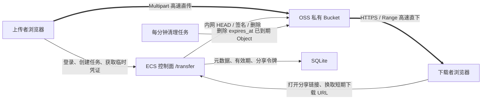

> 历史工程记录的开源脱敏副本。文中的部署结果属于原项目当时的验证记录，示例域名、账号、路径不能用于访问原部署；当前配置以仓库 README 和 docs/DEPLOYMENT.md 为准。

# 长翼久安闪传中心 — 两小时 OSS 高速文件中转实施规划

> 文档状态：实施基线（本地代码与云端部署均已落地）<br>
> 冻结日期：2026-08-04<br>
> 当前阶段：P3 云端部署与端到端验收已通过；ECS/RAM/OSS/Nginx 均已按隔离方案完成<br>
> 权威性：后续开发与验收以本文件为准

> **2026-10-09 下载策略更新：** 用户将修复下载失效作为首要任务。现行 v3 保留浏览器直传上传及可用的 OSS 直下路径；浏览器原生下载、保存权限受限和 CORS 不可核验时，改走本站固定地址的流式兼容下载。该兼容路径经过 ECS 内网读取 OSS，并受 ECS 公网带宽限制。下载兼容地址不含短期 OSS 签名，断线续传保持同一地址；当前实现与验收以 `部署与回滚说明.md` 最新一节为准。下文直连架构条款是原实施基线。

> **零影响硬约束：** 现有 ArgonType、FrameSeen、长翼久安知识库、Nginx 现有路由、端口、systemd 单元和数据目录均不得覆盖、删除或重启。闪传中心必须使用独立目录、独立用户、独立端口和独立服务；Nginx 只允许增加可回滚的 `/transfer/` 路由，且仅在配置测试通过后做优雅 reload。

## 1. 一句话目标

在阿里云服务器部署名为 **“长翼久安闪传中心”** 的极简网页。团队成员通过网页把超大文件高速直传到阿里云 OSS；上传成功后立即得到分享链接和取件码，其他人可通过链接、取件码或最近文件列表下载。当前策略为永久保留，删除改为人工或后续单独的管理策略。

## 2. 需求语义冻结

旧版“保留 2 小时”定义为：

- 计时起点：OSS 已完成 Multipart 合并，并经服务端 `HEAD Object` 校验成功的时刻。
- 计时终点：`completed_at + 2 hours`。
- 上传本身耗费的时间不占用下载有效期。

2026-08-12 起改为永久保留：完成文件的 `expires_at` 为 `NULL`，应用清理器不处理永久文件；OSS 生命周期规则也必须移除，避免云端自动删除覆盖应用策略。
- 到期时不再允许发起新下载。
- 后台清理器每分钟运行一次，物理文件应在到期后 2 分钟内从 OSS 删除。
- 为保证删除语义，下载者应在倒计时结束前完成下载；到期时仍在下载的任务不承诺继续成功。
- 未完成的上传不是“已上传好的文件”，但分片会暂存；超过 6 小时仍未完成的 Multipart 任务自动中止并清理。

这一语义避免“上传 90 分钟后只剩 30 分钟可下载”的问题，也不会把系统做成长期网盘。

## 3. V1 范围

### 必须实现

1. 闪传中心无需访问口令即可打开；取件码和分享链接负责单文件授权。
2. 选择大文件上传（拖放作为后续小增强，不改变直传架构）。
3. 上传进度、并发分片状态和取消。
4. 页面刷新后重新选择同一文件可继续未完成分片；断网重试由 OSS SDK 负责。
5. 上传成功后生成不可猜测的分享链接和易读取件码。
6. 一键复制分享链接或本次上传的取件码。
7. 页面自动识别完整分享链接或取件码并定位到目标文件。
8. 页面下方显示所有仍在 2 小时有效期内的文件，按最新上传排序，可直接点击下载。
9. 下载页展示文件名、大小和剩余有效时间。
10. 下载者无需个人账号；通过团队入口、分享链接或取件码即可下载。
11. 文件数据直接在浏览器与 OSS 之间传输。
12. 到期停止下载授权并自动删除 OSS Object。
13. 上传、下载、过期和删除事件可审计。

### 明确不做

- 不做长期文件盘、目录树、同步盘或团队知识库。
- 不做视频预览、在线编辑、评论和版本管理。
- 不把文件放到家庭服务器。
- 不让 ECS 代理文件数据。
- V1 不做个人账号、复杂组织、部门和多级审批。
- V1 不默认开启 OSS 传输加速或 CDN。
- V1 不承诺 Safari、Firefox 在浏览器重启后的下载续传；Chrome/Edge 是完整能力目标。

## 4. 当前资源与处置决定

已核实的现有 Bucket：`your-oss-bucket`。

当前状态：北京地域、标准存储同城冗余、私有、阻止公共访问已开启、AES-256 服务端加密、空桶、无 CORS、无生命周期、无传输加速。

为减少不必要的云资源变更，V1 计划复用这个空 Bucket，但严格限定到独立前缀：

```text
transfer/v1/{随机分片}/{file_id}/payload
```

约束：

- RAM Policy 只能访问 `transfer/v1/*`。
- 自动删除规则只处理 `transfer/v1/*`。
- 不改动未来可能出现的 FrameSeen Object。
- 如果实施前发现 Bucket 已出现其他数据，则停止复用，改为创建专用 Bucket；不得自动迁移或删除现有对象。

## 5. 系统架构



核心原则：粗线文件流量不经过 ECS。ECS 只处理认证、元数据、STS、签名 URL 和删除指令。

## 6. 用户流程

### 6.1 上传

1. 团队成员进入 `https://files.example.com/transfer/`，主页直接显示操作区和最近两小时文件。
2. 页面只保留一个居中的操作区和最近文件列表。
3. 选择文件；网页显示大小并检查业务上限。
4. 后端创建 `file_id`、Object Key 和上传会话，返回仅可写该 Object 的短期 STS 凭证。
5. 浏览器使用 OSS Browser.js SDK 分片并发上传。
6. 上传成功后，后端核验大小、ETag、CRC64 和加密状态。
7. 后端设置：

```text
completed_at = 当前时间
expires_at   = completed_at + 2 hours
```

8. 页面生成：

```text
分享链接：https://files.example.com/transfer/f/{128-bit随机token}
取件码：7K3M-P9Q2（示例）
```

9. “复制取件码”按钮变为可用，页面同时显示文字级“复制链接”和 2 小时倒计时。

### 6.2 下载

下载入口有三种，但最终走同一条授权链路：

1. 打开 `/transfer/f/{share_token}`；网页从路径自动识别目标文件。
2. 在取件框输入 `7K3M-P9Q2`；也允许直接粘贴完整分享链接，前端自动提取 token 或取件码。
3. 在“最近 2 小时文件”列表中点击文件行。

后端用令牌哈希或取件码哈希查找文件，检查 `AVAILABLE` 和 `expires_at`，签发最多 60 秒的单 Object 下载 URL。下载者直接从 OSS 下载，响应强制为附件。到期后只显示“文件已过期并删除”，不再生成任何 OSS URL。

### 6.3 取件码规则

- 使用 Crockford Base32 的 8 位随机码，显示为 `XXXX-XXXX`。
- 排除 `I/L/O/U/0/1` 等容易看错的字符。
- 数据库保存标准化取件码的 HMAC-SHA256，不保存明文。
- 上传成功响应把明文码返回一次；浏览器在文件有效期内本地保存，供“复制取件码”使用。
- 数据库唯一索引防止碰撞；碰撞时重新生成。
- 团队入口按 IP 限制连续错误；取件码不对外暴露最近文件列表。
- 分享链接使用独立的 128-bit 以上随机 token，不能由取件码推导。

### 6.4 最近文件列表

- 只查询 `status = AVAILABLE AND expires_at > now`。
- 按 `completed_at DESC` 排序，最多显示 50 个。
- 每行显示文件名、大小、上传完成时间、剩余时间和下载图标。
- 整行可点击下载，同时保留明确的键盘焦点和可访问名称。
- 每 15 秒轻量刷新；上传完成、过期或删除时立即局部更新，不整页刷新。
- 列表公开显示最近两小时文件；文件内容仍在私有 OSS 中，下载动作只签发短时 URL。

### 6.5 删除

1. 应用内清理循环每分钟触发；部署时可再加独立 `example-transfer-cleanup.timer` 作为运维兜底。
2. 查询 `expires_at <= now` 且尚未删除的记录。
3. 将状态原子更新为 `DELETING`。
4. 调用 OSS `DeleteObject`。
5. 用 `HEAD Object` 确认返回 404 后记为 `DELETED`。
6. 删除失败采用 1、2、5、10 分钟退避重试并报警。
7. OSS 生命周期规则以 1 天为兜底，清理漏网 Object 和未完成 Multipart；它不负责精确的 2 小时删除。

## 7. 高速传输设计

### 7.1 上传参数

```text
普通上传阈值：8 MiB 以下使用带进度事件的单连接签名 PUT，最多自动重试 3 次
分片大小：max(8 MiB, ceil(file_size / 9000))，按 MiB 向上取整
分片上限：256 MiB
桌面 Multipart 并发：按设备能力动态选择 6～8，且不超过实际分片数
移动端 Multipart 并发：固定 3，兼顾 iOS WebKit 稳定性和链路利用率
断点：浏览器 localStorage 保存 OSS checkpoint，重新选择同一文件后恢复
```

- Object Key 使用 UUID 随机前缀，避免覆盖和顺序热点。
- 请求带 `x-oss-forbid-overwrite: true`。
- Multipart checkpoint 写入浏览器 localStorage（仅保存上传任务元数据与已完成分片，不保存文件内容）。
- STS 有效期 15 分钟；到期前自动刷新，不重新创建上传任务。
- 页面刷新后需要重新选择同一文件，校验 `name + size + lastModified` 后恢复。

### 7.2 下载方式

首版采用 OSS 短期签名 URL 直接下载，不经过应用服务器。OSS 原生支持 Range；Chrome/Edge 可继续扩展为四路 Range 下载管理器。

速度策略：

1. 先测试北京普通 Endpoint 的单连接下载。
2. 如果稳定速度达到客户端可用下行的 80%，保持单连接，兼容性最好。
3. 如果未达到 80%，启用 Chrome/Edge 四路 Range 下载，每路 64 MiB 工作单元。
4. 只有普通 Endpoint 与四路 Range 都不足时，才对传输加速 Endpoint 做 A/B 测试。
5. 传输加速只有在速度提升超过 20% 且用户确认额外费用后才开启。

### 7.3 速度验收口径

```text
利用率 = 实际平均传输速率 / 测试时客户端可用上行或下行速率
```

目标：10 GB 与 100 GB 文件在稳定网络中，上传和下载利用率均达到 80% 以上。测速不把文件读取、浏览器保存对话框和本地磁盘写入时间混入网络速率。

## 8. 安全与权限

### 8.1 使用者边界

- 闪传中心不设置访问口令；任何人可上传，取件码/分享链接或最近文件记录用于下载。
- 独立分享链接可直接打开指定文件，但不展示整个最近文件列表。
- 数据库只存分享令牌和取件码的哈希，不存明文凭证。
- 不建立登录会话；分享令牌和取件码只保存 HMAC 哈希，下载 URL 有效期最多 60 秒。
- 登录和分享接口均限速。

### 8.2 OSS

- Bucket 保持私有。
- 保持“阻止公共访问”开启。
- 保持服务端加密。
- 最低 TLS 收紧为 1.2。
- 浏览器永远不获得长期 AccessKey。
- 上传 STS 会话 Policy 只允许一个 Object Key。
- 下载只使用 60 秒签名 URL。
- 禁止 OSS 列目录；网页文件清单只能读取应用数据库。

### 8.3 CORS

```yaml
AllowedOrigin:
  - https://files.example.com
AllowedMethod:
  - GET
  - HEAD
  - PUT
  - POST
  - DELETE
AllowedHeader:
  - "*"
ExposeHeader:
  - ETag
  - Content-Length
  - Content-Range
  - Accept-Ranges
  - x-oss-request-id
  - x-oss-hash-crc64ecma
MaxAgeSeconds: 600
```

不使用 `*` Origin。

## 9. 应用实现

### 9.1 技术栈

- Node.js 22 原生 HTTP 服务 + 原生 `node:sqlite` WAL。
- `ali-oss` 服务端 SDK 与 Browser.js SDK（静态 vendor 文件）。
- 原生 HTML/CSS/ES modules，无构建型前端框架，减少 ECS 内存与部署面。
- 独立 Node.js systemd 服务，监听未占用的 `127.0.0.1:8810`。
- Nginx 只代理 `/transfer/` 控制请求。
- systemd timer 每分钟执行过期清理。

### 9.2 最小数据表

`files`：

```text
id
object_key
original_name
content_type
size_bytes
etag
crc64
status
share_token_hash
pickup_code_hash
created_at
completed_at
expires_at
deleted_at
delete_attempts
```

`upload_sessions`：

```text
id
file_id
oss_upload_id
expected_size
created_at
last_seen_at
status
```

`audit_events`：

```text
id
action
file_id
ip_hash
user_agent
created_at
```

### 9.3 API

| 方法 | 路径 | 用途 |
|---|---|---|
| POST | `/api/auth/login` | 上传者登录 |
| POST | `/api/uploads` | 创建上传任务与预授权 |
| POST | `/api/uploads/:id/credentials` | 获取或刷新单 Object STS |
| POST | `/api/uploads/:id/complete` | HEAD 校验，开始 2 小时计时 |
| POST | `/api/uploads/:id/abort` | 中止上传并清理分片 |
| GET | `/api/files/recent` | 返回最近 2 小时仍有效的文件 |
| POST | `/api/pickup/resolve` | 自动解析取件码或完整分享链接 |
| GET | `/api/share/:token` | 获取未过期分享页文件信息 |
| POST | `/api/share/:token/download` | 生成 60 秒签名 URL |
| POST | `/api/files/:id/download` | 团队列表文件生成 60 秒签名 URL |
| POST | `/internal/cleanup` | 仅本机可调用的到期清理 |
| GET | `/api/health` | 应用、数据库、OSS 凭证健康检查 |

创建、完成和清理接口必须幂等。客户端重复提交不能延长 `expires_at`。

## 10. OSS 容量与是否需要扩容

结论：**现在不需要扩容，也不存在给这个 Bucket 手动扩磁盘的操作。**

OSS 是弹性对象存储，不是 ECS 云盘。阿里云官方说明 OSS 会自动扩展，单 Bucket 总容量无需预先配置；实际使用多少就按多少计费。需要关注的是费用、单 Object 限制和请求/流量，而不是剩余磁盘空间。

本项目的峰值存储近似为：

```text
峰值容量 = 最近 2 小时所有已完成文件
         + 当前上传中的 Multipart 分片
         + 尚未被清理器删除的短暂过期量
```

例：2 小时内有 10 个 100 GB 文件同时有效，OSS 实际占用约 1 TB；它会自动承载，不需要先买 1 TB“硬盘”。

“存储包、下行流量包、预留空间”只是计费抵扣工具，不是容量开关：

- 没买资源包：默认按实际用量付费，功能正常。
- 买了资源包：符合条件的费用先由资源包抵扣。
- 资源包用完或过期：超出部分自动转为按量付费，文件不会因此无法上传。
- 本项目容量波动大、文件只留 2 小时，初期应保持按量付费；上线一周后再依据账单决定是否买下行流量包。

实施前只需检查账号余额、欠费状态、预算告警和单文件业务上限，不需要做 OSS 扩容。

## 11. 成本控制

- OSS 上传流入流量免费。
- 2 小时保留使存储费非常低；主要成本是外网下载。
- 例：100 GB 文件只保留 2 小时，相当于约 `100 × 2 / 720 = 0.278 GB·月`；按 0.12 元/GB/月的本地冗余示例仅约 0.033 元存储费。当前 Bucket 是同城冗余，实际单价以前台为准。
- 同一个 100 GB 文件每下载一次，就产生约 100 GB 外网流出，因此下载流量远大于存储成本。
- V1 设置每日与每月下载授权总量；超额后停止生成新 URL。
- 阿里云预算设置 50%、80%、100% 告警，但它不是硬停机开关。
- 上线 1 周后根据真实外网下载量决定是否购买流量包。

## 12. 页面与视觉规划

设计系统已落档：[设计系统总则](./design-system/default/MASTER.md)；本页以[首页覆盖规范](./design-system/default/pages/home.md)为最高优先级。

### 12.1 视觉基线

- 产品名固定显示：`长翼久安闪传中心`。
- 纯白背景，标题和主要操作在首屏中央；桌面内容最大宽度 800 px，移动端留 14 px 边距。
- 正文与主按钮使用近黑色，操作条使用极浅灰；不使用蓝色主题、卡片阴影或装饰色块。
- 字体使用系统中文字体栈；标题 30～40 px，按钮与正文保持清晰可读。
- 不用渐变、玻璃拟态、3D、复杂阴影、轮播、装饰性插画或解释性小字。
- 首页不放图标；用短文字按钮维持极简和稳定的跨平台渲染。
- 交互动画仅 150～200 ms 的颜色、透明度和轻微位移；遵守 `prefers-reduced-motion`。

### 12.2 页面结构

```text
┌──────────────────────────────────────────────┐
│             长翼久安闪传中心                  │
│                                              │
│ [上传文件] [复制取件码] [取件码或链接] [取件]  │
│                                              │
│   上传中：文件名 / 进度 / 速度 / ETA            │
│   上传后：取件码 / 复制链接 / 剩余时间            │
│                                              │
│   最近文件                                   │
│   文件名       大小       剩余时间       ↓      │
│   文件名       大小       剩余时间       ↓      │
└──────────────────────────────────────────────┘
```

主页面不设置顶部导航、侧边栏、统计图和营销模块。

### 12.3 首屏按钮

- `上传文件`：黑色主按钮，高度至少 48 px；通过文件选择器进入上传。
- `复制取件码`：透明次按钮；上传完成前禁用，完成后复制本次上传码并短暂显示“已复制”。
- 结果区另提供文字级“复制链接”，避免再增加第三个大按钮。
- 所有操作支持键盘、可见焦点、44×44 px 最小触控面积和 `aria-live` 状态反馈。

### 12.4 自动识别

- 访问 `/transfer/f/{token}` 时自动打开对应文件下载卡片。
- 取件输入框同时接受 `XXXX-XXXX`、不带横线的 8 位码和完整分享链接。
- 粘贴后自动清洗空格、统一大写并解析；解析成功直接定位目标文件。
- 不在用户刚打开普通首页时读取系统剪贴板，避免浏览器权限弹窗和隐私问题。
- 不未经确认自动下载；自动定位后由用户点击“下载文件”，防止误下载和浏览器拦截。

### 12.5 上传状态

- 展示文件名、已传/总大小、实时 MB/s、上传进度、并发数、分片大小和阶段提示。
- 提供取消和断点恢复提示；暂停/继续留作后续增强，不改变当前传输架构。
- OSS 校验和取件码生成成功后自动收起上传进度框，只保留分享链接、取件码和倒计时。

### 12.6 最近文件与下载状态

- 列表行显示文件名、大小、剩余时间和下载图标，整行可点击。
- 下载卡片显示文件名、大小、剩余时间和高速下载按钮；不展示 Bucket 或 Object Key。
- 过期后只展示“文件已过期并删除”。
- 列表为空时显示“最近 2 小时还没有文件”，不展示虚构示例。

移动端可以打开下载页；超大文件下载主要以桌面 Chrome/Edge 为验收环境。

## 13. 实施阶段

| 阶段 | 内容 | 完成门槛 |
|---|---|---|
| P0 只读复核 | 实施当天再次确认 Bucket 仍为空、ECS 服务边界和现有网站健康 | 不覆盖现有对象或服务 |
| P1 云权限 | 前缀级 RAM、ECS Role、CORS、TLS、兜底生命周期 | STS 只能写一个 Object；无匿名访问 |
| P2 应用 | 团队入口、上传、取件码、链接自动识别、最近列表、下载、倒计时、SQLite、清理器 | 已完成 512 MiB 浏览器直传、OSS 校验、取件码和自动收起验收 |
| P3 独立部署 | 独立目录/用户/端口、systemd、Nginx 增量路由、回滚 | 已部署到独立 8810 服务；现有业务未重载，发布可回滚 |
| P4 大文件验收 | 10/100 GB、断网、刷新、取件码、最近列表、过期删除、速度测试 | 第 14 节全部通过 |

预计 3～5 个工程日。速度测试受上传端与下载端真实网络条件影响，不把运营商带宽不足误判为程序故障。

## 14. 上线验收门槛

必须全部通过：

1. 100 GB 文件数据不经过 ECS；传输期间 ECS 网卡只有控制流量。
2. 上传成功后分享页立即可用，倒计时从 `02:00:00` 开始。
3. 上传完成后生成唯一取件码；带横线码、无横线码和完整链接都能定位同一文件。
4. 最近列表只展示仍有效文件，到期后在一次刷新周期内消失。
5. 10 GB 和 100 GB 上传达到可用上行的 80%。
6. 10 GB 和 100 GB 下载达到可用下行的 80%；不足时验证 8～12 路 Range 方案。
7. 上传 30% 时断网，恢复后不重传已完成分片。
8. 页面刷新和 STS 过期后可以恢复上传。
9. 未通过团队入口的匿名用户不能列举最近文件。
10. 分享 URL 到期后立即停止签发下载 URL。
11. OSS Object 在到期后 2 分钟内删除，`HEAD Object` 返回 404。
12. 清理器重启、重复执行和 DeleteObject 暂时失败时不会漏删或错误延长有效期。
13. 前端包、日志、SQLite 和源码中不存在长期 AccessKey。
14. 375、768、1024、1440 px 均无横向滚动；按钮、焦点、对比度通过可访问性检查。
15. ArgonType、FrameSeen 和现有 `files.example.com` 路由在部署前后 smoke test 一致。

## 15. 实施前最后检查项

以下默认值已经替用户做出，除非实施前被明确修改：

| 项目 | 默认决定 |
|---|---|
| 2 小时起算 | 上传完成并校验成功 |
| 页面名称 | 长翼久安闪传中心 |
| 团队主页面 | 无访问口令，打开即用 |
| 独立分享链接 | 无需登录，只展示指定文件 |
| 取件码 | 8 位 Crockford Base32，显示为 `XXXX-XXXX` |
| 到期删除误差 | 不超过 2 分钟 |
| 到期时尚未完成的下载 | 不保证继续 |
| 未完成上传清理 | 6 小时 |
| 首选地域 | 华北 2（北京） |
| 首选 Bucket | 复用现有空桶的 `transfer/v1/` 前缀 |
| 首选网页路径 | `https://files.example.com/transfer/` |
| 零影响策略 | 只新增独立服务和可回滚 Nginx 路由；不 restart 现有服务 |
| 传输加速 | 当前关闭；属于额外计费项，获得费用授权后再开启 A/B 测试 |
| 核心桌面浏览器 | Chrome / Edge |

## 16. 官方技术依据

- [OSS Browser.js 断点续传上传](https://help.aliyun.com/zh/oss/developer-reference/resumable-upload-9/)
- [Browser.js SDK 与 CORS](https://help.aliyun.com/en/oss/developer-reference/installation)
- [Multipart Upload 限制与权限](https://help.aliyun.com/zh/oss/user-guide/multipart-upload)
- [STS 临时访问凭证](https://help.aliyun.com/zh/oss/developer-reference/use-temporary-access-credentials-provided-by-sts-to-access-oss)
- [OSS 流量费用](https://help.aliyun.com/zh/oss/traffic-fees)
- [生命周期规则](https://help.aliyun.com/zh/oss/user-guide/overview-54/)
- [清理未完成 Multipart 碎片](https://help.aliyun.com/zh/oss/user-guide/delete-parts)
- [OSS 自动扩展且 Bucket 总容量无需预配置](https://www.alibabacloud.com/help/en/oss/faq-15)
- [OSS 资源包：用完后转按量付费](https://help.aliyun.com/zh/oss/resource-plan/)

## 17. 2026-08-04 实测与极速内核决策

### 17.1 当前实测

同一台客户端使用 512 MiB 合成文件，走生产域名和北京 OSS 标准 Endpoint：

| 链路 | 结果 |
|---|---:|
| 浏览器 8 路 Multipart 上传：创建任务到 OSS HEAD 校验完成 | 56.595 秒，约 9.05 MiB/s |
| 单连接 OSS 签名 URL 下载 | 175.089 秒，约 2.92 MiB/s |
| 8 路 HTTP Range 并行下载 | 29.037 秒，约 17.63 MiB/s |
| 12 路 HTTP Range 并行下载 | 22.337 秒，约 22.92 MiB/s |

结论：当前普通下载受单连接/公网路由影响明显，12 路 Range 比单连接快约 7.8 倍；但当前端到端链路仍不足以保证 50～100 MiB/s。该目标分别需要至少约 400～800 Mbps 的持续有效带宽，且不能存在运营商、Wi-Fi、磁盘或远程路由瓶颈。

### 17.2 已落地的网页极速内核

- 上传：8 MiB 以下使用单连接签名 PUT，避免极小文件被强制拆成 Multipart；8 MiB 及以上使用 8 MiB 起始分片，桌面按 CPU 与实际分片数动态选择 6～8 路并发，移动端固定 3 路；分片失败从检查点最多重试 3 次，100 MiB 以下最终可自动回退兼容直传。
- 下载：桌面 Chrome/Edge 使用 File System Access API，按 32 MiB 分段、最多 12 路 Range 并行、乱序到达后按偏移直接写盘，不把超大文件整体放进内存。
- 长任务：签名 URL 过期或分段失败时自动刷新 URL 并重试；失败自动回退普通 OSS 下载。
- 交互：仍然只有一个“下载”按钮；极速协议选择对用户透明，下载过程复用精简进度条并显示实时速度。
- 兼容：不支持 File System Access API 的浏览器保持普通签名 URL 下载，不阻塞基本取件能力。

### 17.2.1 2026-08-04 上传卡死热修验收

- 原因：小文件仍被强制走 16 MiB Multipart，并发数大于实际分片数；取消流程同步等待 OSS 中止请求，移动网络不返回时界面无法释放。
- 修复：取消先中断本地 XHR/SDK 任务并立即收起界面，OSS 中止改为后台限时执行；取消后的旧 Promise 不得恢复进度框或展示错误。
- 错误展示：浏览器网络、超时和 OSS XHR 失败只显示简短中文提示，完整底层错误只写开发者控制台，不向用户铺开内部 Endpoint 与查询参数。
- 生产验收：4 MiB 文件完整上传、OSS HEAD 校验和取件信息生成成功；96 MiB 文件在 7% 时显示 `6.72 MB / 96.0 MB · 211 KB/s`，点击取消后 1.53 秒内收起，4 秒后未反弹，上传按钮恢复可用。
- 清理验收：4 MiB 测试对象经现有清理器一次删除成功并记为 `DELETED`；取消的 96 MiB 单 PUT 任务记为 `ABORTED`，不会生成半成品 Object。

### 17.2.2 2026-08-04 中型文件吞吐回归修复

- 证据：iPhone 上传 27.24 MiB 的 `IMG_2319.mov` 走单连接耗时 32.774 秒，只有 0.831 MiB/s；同一系统此前并行分片的 23.71 MiB 与 41.74 MiB 文件分别达到 5.539 和 5.565 MiB/s。
- 原因：卡死热修把单连接阈值设成 100 MiB，导致常见视频失去并行能力。
- 修复：单连接阈值下调到 8 MiB；移动端使用 3 路、桌面最多 8 路并行分片，并增加检查点级重试及中型文件直传回退。
- 发布：`/opt/fast-changyi/releases/20260804-163224`，前端缓存版本 `20260804-5`。
- 边界：家庭宽带已知上行约 30～50 Mbps，理论上限约 3.75～6.25 MB/s；网页并发可以逼近可用上行，但不能把物理上行变成 50～100 MB/s。

### 17.3 P2P 混合内核（下一阶段）

采用 `WebRTC DataChannel P2P + OSS Range` 双源调度，不用 P2P 替代 OSS：

1. 上传者完成 OSS 上传后，在页面保持在线并作为临时 Seeder。
2. 下载者携带分享 Token 进入内存信令房间，优先和上传者/已下载者建立 WebRTC 直连。
3. 文件按内容哈希分块；调度器同时从多个 P2P Peer 和 OSS 请求不同缺块，依据实时吞吐、RTT 和失败率动态择快。
4. P2P 不可达、上传者离线、NAT 必须中继或块校验失败时，立即由 OSS 补片。
5. 每块使用 SHA-256 校验，最终按文件清单复核，取件权限和两小时失效规则仍由现有服务控制。

P2P 在同一局域网、直连网络或多人同时取同一文件时收益最大；只有一个来源、跨运营商直连质量差或必须走 TURN 时不保证加速。正式投入使用前还需要独立信令限流、STUN/TURN 选型和双设备实网验收。

### 17.4 OSS 传输加速

阿里云传输加速可把客户端请求就近接入阿里云边缘，再走其骨干网到 Bucket；开启功能本身不收费，但只有改用加速 Endpoint 才生效，并产生单独的加速流量费用，下载还会叠加外网流出费用。应保留标准 Endpoint 作为回退，在获得费用授权后开启并等待约 30 分钟，再用相同 512 MiB 文件做标准/加速 A/B 测试。
